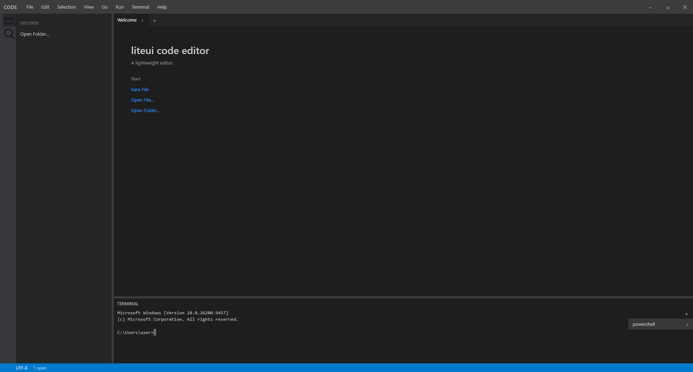
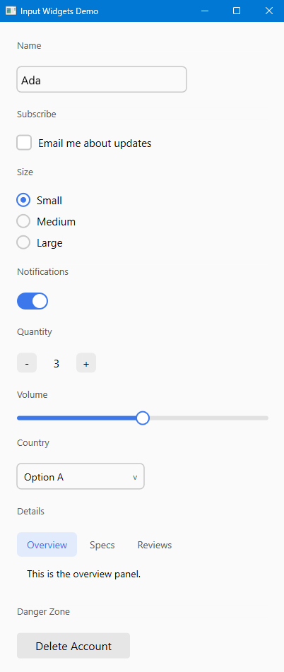
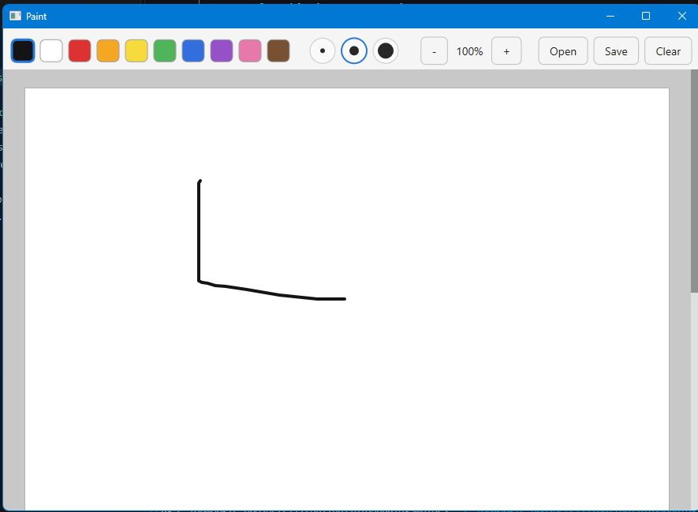

# liteui

A single-header, retained-mode GUI library for C++23. Copy in one file,
define `LITEUI_IMPLEMENTATION` in exactly one `.cpp`, and start building —
native rendering on both platforms (Direct2D/DirectWrite on Windows,
Wayland/EGL/Cairo/Pango on Linux).

```cpp
#define LITEUI_IMPLEMENTATION   // in exactly one .cpp of your project
#include "liteui.hpp"

int main() {
  int count = 0;

  Text label;
  label.label = [&]() { return "Count: " + std::to_string(count); };
  label.fontSize = 20;

  View button;
  button.style.width = Size::pixel(140);
  button.style.height = Size::pixel(44);
  button.style.borderRadius = 6.0f;
  button.style.backgroundColor = Color{230, 230, 230};
  button.style.hoverColor = {210, 210, 210};
  button.style.alignItems = Align::Center;
  button.style.justifyContent = Justify::Center;
  button.onClick = [&]() { count++; };

  Text buttonLabel;
  buttonLabel.label = "Increment";
  button.addChild(buttonLabel);

  View root;
  root.style.direction = FlexDirection::Column;
  root.style.alignItems = Align::Center;
  root.style.justifyContent = Justify::Center;
  root.style.gap = 16;
  root.style.width = Size::full();
  root.style.height = Size::full();
  root.addChild(label);
  root.addChild(button);

  LiteUI ui("Counter", 400, 200);
  ui.setRoot(root);
  ui.run();
}
```

The `#define LITEUI_IMPLEMENTATION` line is what compiles the library
itself into this file, so it goes in exactly one `.cpp` (here, the only
one). Every other file that uses liteui just writes
`#include "liteui.hpp"` without it. This is true with CMake too: the
`liteui::liteui` target supplies the include path, the C++23 requirement
and the platform libraries, but not the implementation, so each
executable still defines the macro in exactly one `.cpp` (see
[Getting started](#getting-started)).

## Screenshots

| Code editor | Input widgets | Paint |
|---|---|---|
|  |  |  |

## What's in the header

- A retained `View` tree with a flexbox-subset layout engine — `Size`
  (Fixed/Percentage/Fit/Full), row/column direction, wrap,
  justify/align-content, absolute positioning, and per-axis
  overflow/scrolling with real scrollbars.
- `Text` and `Canvas` leaf nodes. Canvas exposes an HTML5-canvas-style
  2D drawing API (paths, gradients, shadows, composite operators,
  image draw/get/put) backed by Direct2D on Windows and Cairo on Linux.
- `TextInput`, `Image`, and `Svg` convenience nodes built on top of
  `Canvas` — a single-line text field with caret/selection, an
  `object-fit`–aware image node (PNG/JPEG decoding included), and a
  small dependency-free SVG parser/renderer.
- `Dynamic<T>` — every meaningful style/content field can be a plain
  value or a `std::function<T()>` polled once per dispatch cycle, so
  `label.label = [&]{ return someState; };` just works without a
  virtual-DOM diffing layer.
- Keyed dynamic list children (`keysSource` / `itemBuilder`) for
  todo-app-style add/remove where only the changed subtree rebuilds.
- Mouse, keyboard, focus, tooltips, clipboard, native file/folder
  pickers, and a custom client-side titlebar on Linux (Windows uses
  native decorations).

See [`docs/PLATFORM_NOTES.md`](docs/PLATFORM_NOTES.md) for the current
list of known per-backend limitations (gradients, shadows, `getImageData`,
SVG feature coverage, etc.) before relying on any of the above.

## Supported platforms

| Platform | Rendering | Windowing |
|---|---|---|
| Windows | Direct2D + DirectWrite | Win32 |
| Linux | Cairo/Pango (2D + text) + EGL/GLES2 (compositing) | Wayland (xdg-shell) |

There is no X11 backend and no macOS backend at this time.

## How the single header works

`liteui.hpp` has two halves, in the style of `stb_*.h`:

- **Declarations** (always visible): the types, `View`, `Canvas`,
  `LiteUI`, and the clipboard / file-picker / image-decoding functions.
  This part includes only a handful of standard headers and none of the
  platform headers, so including it from many files is cheap.
- **Implementation** (compiled only where you ask for it): the Win32 or
  Wayland backend, the layout engine, text rendering, the SVG/XML
  parsers and image decoders. It is compiled in the one translation unit
  that defines `LITEUI_IMPLEMENTATION` before including the header.

```cpp
// main.cpp  (any one .cpp file in your project)
#define LITEUI_IMPLEMENTATION
#include "liteui.hpp"
```

Every other file just writes `#include "liteui.hpp"`. A project with a
single `.cpp` does both in that file. Defining `LITEUI_IMPLEMENTATION`
in more than one file is an error (duplicate symbols).

Why split it this way: the implementation is roughly ten thousand lines
of non-template code. In a plain header-only library every `.cpp` that
includes it compiles all of that again and the linker throws the copies
away, so build time grows with the number of files that use liteui.
Compiling it once keeps your own files fast to build.

For a tour of how the library itself is organized (the public/implementation
boundary, the frame pipeline, and the Windows and Wayland backends), see
[`docs/ARCHITECTURE.md`](docs/ARCHITECTURE.md).

## This is not a zero-dependency header

Unlike `stb_*.h`, liteui talks directly to each platform's native
GUI/graphics stack, so linking against system libraries is required —
including the header alone is not enough to produce a working program.
This is closer to how GLFW or Dear ImGui's platform backends work than
to stb.

Only the translation unit that defines `LITEUI_IMPLEMENTATION` needs the
platform headers; your other files never include them. (The CMake target
passes the platform include paths and libraries to every target that
links it, which is harmless.)

| Platform | Required libraries |
|---|---|
| Windows | `user32`, `gdi32`, `d2d1`, `dwrite`, `windowscodecs`, `ole32` |
| Linux | `wayland-client`, `wayland-cursor`, `wayland-egl`, `cairo`, `pangocairo`, `egl`, `glesv2`, `xkbcommon`, `libpng`, `libjpeg` (all resolvable via pkg-config) |

## Getting started

### With CMake (recommended)

```cmake
add_subdirectory(path/to/liteui)   # or FetchContent_Declare + FetchContent_MakeAvailable
target_link_libraries(your_app PRIVATE liteui::liteui)
```

`liteui::liteui` is a header-only `INTERFACE` target. Linking it gives
you the include directory, the C++23 requirement, the optional
`LITEUI_PROFILE` define, and every platform link library above — you
don't need to write your own `find_package`/`pkg_check_modules` calls.
The implementation is **not** prebuilt: in exactly one `.cpp` of each
executable, define `LITEUI_IMPLEMENTATION` before including the header.

```cpp
// main.cpp
#define LITEUI_IMPLEMENTATION
#include "liteui.hpp"
```

If a program is split across several targets (say an app plus a library
that both use liteui), put the `#define` in only one of them; defining
it twice in one program is a duplicate-symbol link error.

On Linux, the Wayland protocol bindings (`xdg-shell`,
`xdg-decoration`) are pre-generated and checked into
`platform/wayland-protocols/`, so building liteui does **not** require
`wayland-scanner` or the `wayland-protocols` package — only the
runtime libraries in the table above.

#### "vendored Wayland protocol sources not found"

If you see this error, it means you're building from a checkout where
`platform/wayland-protocols/*.c`/`*.h` haven't been generated yet
(e.g. a fresh clone before they were committed, or you're building
liteui itself for the first time rather than just consuming it as a
dependency). Fix it once:

```bash
sudo apt install libwayland-bin wayland-protocols   # provides wayland-scanner + the protocol XML
cmake -B build      # configures with a WARNING instead of failing, once wayland-scanner is found
cmake --build build --target regen-protocols
git add platform/wayland-protocols && git commit
```

After that one-time step, `platform/wayland-protocols/` is populated
and committed, and every subsequent `cmake -B build` configures
cleanly without needing `wayland-scanner` or `wayland-protocols`
installed at all.

### Without CMake

1. Copy `liteui.hpp` into your project.
2. In exactly one `.cpp` file, define `LITEUI_IMPLEMENTATION` before
   including it (see [How the single header works](#how-the-single-header-works)).
3. Build that file with the platform headers available and link the
   libraries from the table above.

On Linux, that one file additionally needs
`-Iplatform/wayland-protocols` (the header includes
`xdg-shell-client-protocol.h` and `xdg-decoration-client-protocol.h` from
there), the compile flags from
`pkg-config --cflags wayland-client wayland-cursor wayland-egl cairo pangocairo egl glesv2 xkbcommon libpng libjpeg`,
and you must compile `platform/wayland-protocols/xdg-shell-protocol.c`
and `platform/wayland-protocols/xdg-decoration-protocol.c` into your
build — they're plain C files, no code generation needed at your end.

## Examples

Every directory under [`examples/`](examples/) is a small, focused,
single-file program demonstrating one feature (text input, image loading,
menus, split panes, a paint canvas, a file explorer, etc.).

```bash
cmake -B build -S .
cmake --build build --target counter
./build/examples/counter/counter  # build/examples/counter/Debug/counter.exe on multi-config generators
```

Swap `counter` for any example. Each example is a subdirectory,
`examples/<name>/{CMakeLists.txt,main.cpp}`, and is picked up
automatically on the next configure. Its CMakeLists is just:

```cmake
add_executable(hello main.cpp)
target_link_libraries(hello PRIVATE liteui::liteui)
```

`CMakePresets.json` provides ready-made configurations too: `msvc-debug`,
`msvc-release` (plus `-profile` variants with `LITEUI_PROFILE=ON`) on
Windows, and `gcc-debug`, `gcc-release` on Linux. Build output then goes
to `build/<preset-dir>/` instead of `build/`:

```bash
cmake --preset gcc-debug
cmake --build --preset gcc-debug-build
```

The MSVC presets use Ninja with `cl.exe`, so run them from a Visual
Studio Developer Prompt.

## License

See [`LICENSE`](LICENSE).