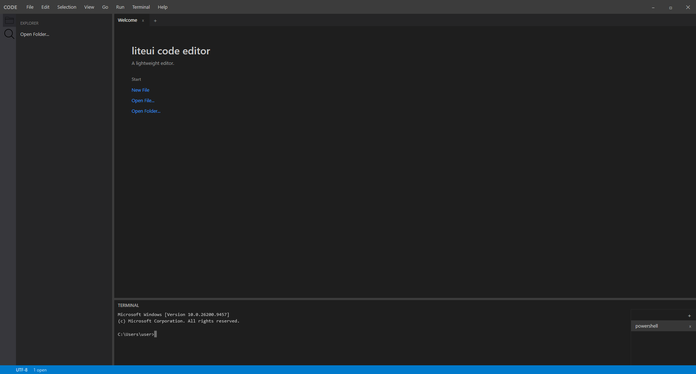
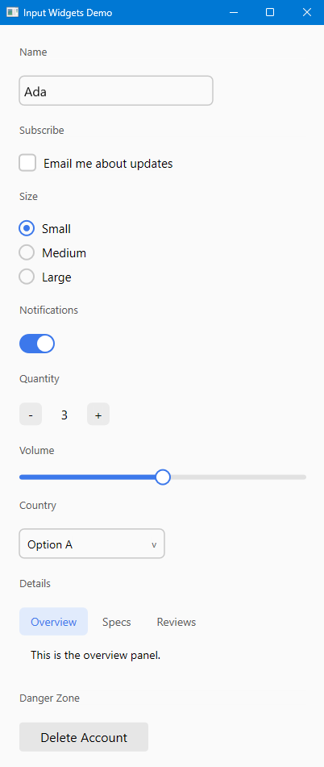
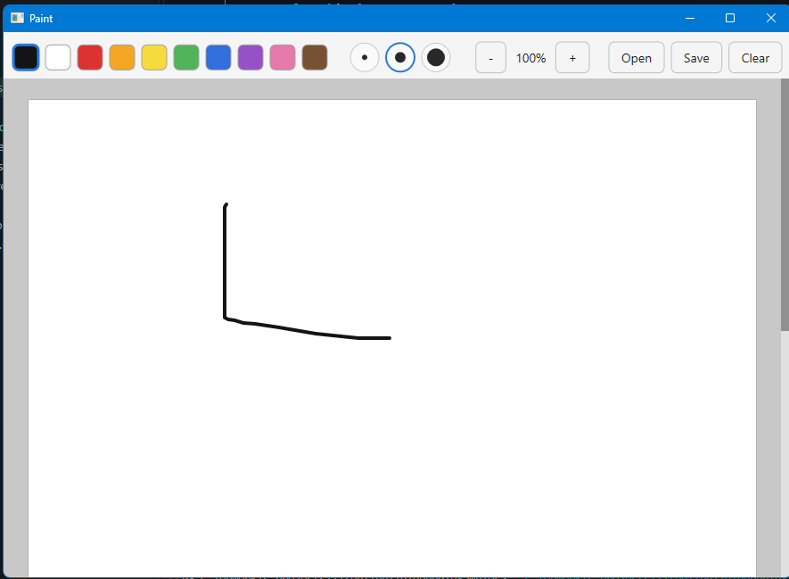

# LiteUI

A single-header, retained-mode C++23 GUI library with a flexbox-style layout engine and native rendering backends: **Direct3D 11 + Direct2D + DirectWrite** on Windows and **Wayland + EGL/OpenGL ES 3.0 + Cairo/Pango** on Linux. Both draw on the GPU, and mouse, pen and touch input share one event model.

```cpp
#define LITEUI_IMPLEMENTATION
#include "liteui.hpp"

int main()
{
    Text label;
    label.label = std::string("Hello World");
    label.fontSize = 20;

    View root;
    root.style.direction = FlexDirection::Column;
    root.style.alignItems = Align::Center;
    root.style.justifyContent = Justify::Center;
    root.style.width = Size::full();
    root.style.height = Size::full();
    root.addChild(label);

    LiteUI ui("Hello World", 400, 200);
    ui.setRoot(root);
    ui.run(); // blocks, pumps the platform event loop
}
```

## Screenshots

| Code editor | Inputs | Paint |
|:---:|:---:|:---:|
| [](examples/others/codeeditor.cpp) | [](examples/others/inputs.cpp) | [](examples/others/paint.cpp) |

Each image links to the single-file demo that produced it, all built from the same `liteui.hpp`. The demos are in [`examples/others/`](examples/others/).

## Contents

- [Screenshots](#screenshots)
- [Why LiteUI](#why-liteui)
- [Platform support](#platform-support)
- [Getting started](#getting-started)
- [Core concepts](#core-concepts)
- [Examples](#examples)
- [Building, testing and profiling](#building-testing-and-profiling)
- [Project layout](#project-layout)
- [Known limitations](#known-limitations)
- [Documentation](#documentation)
- [License](#license)

## Why LiteUI

- **One header.** Everything lives in `liteui.hpp`. Declarations are cheap to include; the platform backend is compiled in exactly one translation unit per program (see [Using the header](#using-the-header)).
- **Retained tree, declarative-ish authoring.** You build a tree of `View`s, set a `Style`, attach callbacks, and hand it to `LiteUI::setRoot`. The library lays it out, paints it, and keeps it up to date.
- **Flexbox-subset layout.** Row/column direction, `justifyContent`, `alignItems`, `gap`, wrapping with `alignContent`, `flexGrow`/`flexShrink`, min/max sizes, margin/padding, absolute positioning, z-index, `display: none` and `visibility: hidden` analogs, and per-axis overflow with scrollbars.
- **`Dynamic<T>` fields.** Most style and text fields accept either a plain value or a callback. LiteUI re-polls the callbacks after every dispatched event, so UI state is "assign a lambda once", not "push updates by hand".
- **Keyed lists.** Declare a list of keys and an item builder; survivors are reused untouched (cached text, canvas surfaces, scroll offsets), so adding or removing a row costs one build, not a rebuild of the whole list.
- **Pointer events for mouse, pen and touch.** One DOM-style event type with bubbling, pointer capture, double-click, wheel, pen pressure and tilt, and batched pen samples for smooth strokes.
- **Built-in leaf nodes.** `Text`, `TextInput`, `Canvas` (a GPU-accelerated, HTML5-2D-context-style API), `Image` (PNG/JPEG and more on Windows, including 16-bit and float sources) and `Svg` (a vector subset that re-renders crisply at any size).
- **Small platform helpers.** File/folder pickers, clipboard access, image decoding and encoding, timers, global shortcuts, tooltips, frameless windows with custom title bars, and a thread-safe `wake()`.
- **No virtual interface layer.** Platform differences are selected at compile time with `#if`, not through a runtime abstraction. `LiteUI` is a thin handle over the platform implementation.

## Platform support

| Platform | Window system | Rendering | Text | Notes |
|---|---|---|---|---|
| Windows | Win32 | Direct2D on a Direct3D 11 swap chain (WARP software fallback) | DirectWrite | Images via WIC; pen and touch via `WM_POINTER*` |
| Linux | **Wayland only** (xdg-shell) | EGL + **OpenGL ES 3.0** | Pango (rasterized with Cairo) | Images via libpng/libjpeg; touch via `wl_touch`, pen via tablet-v2 |

macOS and X11 are not supported. Linux needs a GPU driver that provides OpenGL ES 3.0. On Linux, LiteUI draws its own 32 px title bar (with minimize/maximize/close) unless you create the window with `hideTitlebar = true`.

The bundled CMake presets use **MSVC** on Windows and **GCC** on Linux. The project requires **C++23** (set for you by the `liteui::liteui` target).

## Getting started

New to LiteUI? The [step-by-step tutorial](docs/GETTING_STARTED.md) builds a counter, a todo list, a custom-drawn widget and a background worker. The sections below are the short version.

### Using the header

Include `liteui.hpp` wherever you need the API. In **exactly one** `.cpp` file of each executable, define `LITEUI_IMPLEMENTATION` first. That is the translation unit that compiles the backend and sees the platform headers:

```cpp
// ui.cpp
#define LITEUI_IMPLEMENTATION
#include "liteui.hpp"
```

A program with a single `.cpp` just does both in that file. Defining it in more than one translation unit of the same program will produce duplicate symbols.

### With CMake (recommended)

`liteui::liteui` is a header-only `INTERFACE` library. Because the implementation is compiled inside *your* executable, linking it supplies everything the backend needs: the include path, `cxx_std_23`, the platform libraries, and (on Linux) the vendored Wayland protocol bindings.

```cmake
add_subdirectory(path/to/liteui)          # or FetchContent, see below

add_executable(app main.cpp)
target_link_libraries(app PRIVATE liteui::liteui)
if(MSVC)
    target_compile_options(app PRIVATE /utf-8)
endif()
```

With `FetchContent`:

```cmake
include(FetchContent)
FetchContent_Declare(liteui
    GIT_REPOSITORY <your liteui repository URL>
    GIT_TAG        main)
FetchContent_MakeAvailable(liteui)
```

When LiteUI is pulled in as a subproject it never downloads Catch2 and never builds its tests or examples. Those are top-level only.

### Without CMake

Copy `liteui.hpp` into your project and compile with C++23. You must provide the platform pieces yourself:

- **Windows:** link `user32 gdi32 d3d11 dxgi d2d1 dwrite windowscodecs ole32`.
- **Linux:** link wayland-client, wayland-cursor, wayland-egl, cairo, pangocairo, egl, glesv2, xkbcommon, libpng and libjpeg, compile the generated `xdg-shell`, `xdg-decoration` and `tablet` protocol `.c` files, and put their headers on the include path (the header includes `xdg-shell-client-protocol.h`, `xdg-decoration-client-protocol.h` and `tablet-client-protocol.h`). The repository ships these under `platform/wayland-protocols/`. Also define `LITEUI_CANVAS_GL` for the OpenGL ES canvas backend (the CMake target does this for you on Linux); without it you get the Cairo canvas backend. See [`docs/BUILDING.md`](docs/BUILDING.md) for a complete command line.

### Dependencies

**Windows:** the Windows SDK and a C++23-capable MSVC. Nothing else.

**Linux:** development packages for the libraries above, and a GPU driver with OpenGL ES 3.0 (Mesa on most hardware). On Debian/Ubuntu (package names vary by distribution):

```sh
sudo apt install build-essential cmake ninja-build pkg-config \
    libwayland-dev libxkbcommon-dev libcairo2-dev libpango1.0-dev \
    libegl-dev libgles-dev libpng-dev libjpeg-dev
```

The generated Wayland protocol bindings are **vendored** in `platform/wayland-protocols/`, so you do *not* need `wayland-scanner` or the `wayland-protocols` package to build. They are only needed if you want to regenerate the bindings (see [Regenerating the Wayland bindings](#regenerating-the-wayland-bindings)).

Optional runtime tools on Linux:

| Feature | Uses | Without it |
|---|---|---|
| File and folder pickers | `zenity`, falling back to `kdialog` | Pickers return `std::nullopt` / an empty vector |
| System clipboard | `wl-copy`/`wl-paste` (Wayland), or `xclip` / `xsel` (when `DISPLAY` is set) | Clipboard falls back to a same-process buffer |

## Core concepts

### The View tree

A `View` is a node with a `Style` and `children`. Build the tree with `addChild`, then give it to a window with `setRoot`. **`addChild` and `setRoot` copy the tree**, so build children completely before adding them, and keep any state your callbacks refer to alive for as long as the window runs (typically locals in `main`, captured by reference).

```cpp
View row;
row.style.direction = FlexDirection::Row;
row.style.gap = 8;
row.style.padding = EdgeInsets::all(12);
row.addChild(label);          // Text, Canvas, TextInput, Image and Svg
row.addChild(otherView);      // flatten into Views automatically
```

`Text`, `Canvas`, `TextInput`, `Image` and `Svg` are *author-facing* leaf descriptions. `addChild` flattens each into a `View`, so the retained tree only ever contains `View`s.

### Layout

`Style` follows the flexbox model with a pragmatic subset of CSS vocabulary.

| Area | Fields |
|---|---|
| Size | `width`, `height` (`Size::pixel(n)`, `Size::percentage(n)`, `Size::fit()`, `Size::full()`), `minWidth`/`maxWidth`/`minHeight`/`maxHeight` |
| Spacing | `margin`, `padding` (`EdgeInsets`, or `EdgeInsets::all(n)`), `gap` |
| Flex | `direction` (`Row`/`Column`), `justifyContent`, `alignItems`, `flexWrap`, `alignContent`, `flexGrow`, `flexShrink` |
| Box | `backgroundColor`, `borderWidth`, `borderColor`, `borderRadius`, `hoverColor`, `cursor` |
| Positioning | `position` (`Static`/`Absolute`), `left`/`top`/`right`/`bottom`, `zIndex`, `escapeClip` |
| Visibility | `display` (`Flex`/`None`: removed from layout, paint and hit-testing), `visibility` (`Visible`/`Hidden`: keeps its space) |
| Scrolling | `overflowX`/`overflowY` (`Visible`, `Hidden`, `Scroll`, `Auto`), `wheelScrollEnabled`, `contentPanEnabled`, scrollbar colors and `scrollbarAutoHide` |

`Size::Fit` sizes to content, `Size::Full` fills the space the parent offers on that axis. Absolute children are pulled out of flex flow and placed against the parent's content box. Unset absolute edges are `NaN` (the default).

### `Dynamic<T>`: values or callbacks

A `Dynamic<T>` field holds either a `T` or a `std::function<T()>`. Assign whichever is convenient:

```cpp
int count = 0;

Text label;
label.label = std::string("static text");                              // plain value
label.label = [&] { return "Clicked " + std::to_string(count); };      // callback

view.style.backgroundColor = Color{40, 40, 40};                         // plain value
view.style.backgroundColor = [&] { return count > 5 ? Color{200, 0, 0}
                                                    : Color{40, 40, 40}; };
```

Callbacks are polled after every dispatched event (pointer, key, wheel, interval tick, wake) and once when you call `setRoot`. If a value changed, LiteUI relayouts and repaints; if nothing changed, nothing is redrawn. Callbacks should therefore be cheap and side-effect free. Use `Dynamic<float>` fields with float literals (`8.0f`), since an `int` assigned to a `std::variant<float, ...>` is a narrowing conversion and will not compile.

### Events

Handlers are plain `std::function`s on `View` (and on `Canvas`). Mouse, pen and touch all produce the same `PointerEvent`: the position (`x`/`y` local to the view, `windowX`/`windowY` in the window), the `button` that changed, a `buttons` bitmask, the modifier keys, and pen data (`pressure`, `tiltX`/`tiltY`, `eraser`). A pen tip or a finger counts as the left button.

| Category | Members |
|---|---|
| Pointer | `onPointerDown`, `onPointerMove`, `onPointerUp`, `onPointerCancel`, `onPointerEnter`, `onPointerLeave`. A press **captures** the pointer, so moves and the release keep arriving even when the pointer leaves the view |
| Clicks | `onClick` (left button), `onDoubleClick`, `onAuxClick` (middle), `onContextMenu` (right). They **bubble** up to the nearest ancestor with a handler, unless a handler taking `PointerEvent &e` calls `e.stopPropagation()` |
| Wheel | `onWheel`. Bubbles; call `e.stopPropagation()` to use the wheel yourself instead of the built-in scrolling |
| Keyboard | `focusable`, `onFocus`, `onBlur`, `onKeyDown`, `onKeyUp`, `onTextInput(codepoint)`. Only the focused view receives them |
| Layout | `onLayout(x, y, w, h)` fires after each layout so you can read a view's real box |
| Tooltip | `tooltip = "text"`, styled with `LiteUI::setTooltipStyle` |
| Cursor | `style.cursor` (`Cursor::Pointer`, `Text`, `Crosshair`, `Grab`, ...), inherited from the parent |

`onClick` accepts either `[&] { ... }` or `[&](PointerEvent &e) { ... }`. The short form ends bubbling; the long form lets you look at the event or let it continue. Views without a handler for an event, and disabled views, are transparent to the pointer. The full model (capture, cancel, coalesced pen samples, touch) is in [`docs/API.md`](docs/API.md#pointer-events).

Window-level hooks live on `LiteUI`:

```cpp
LiteUI ui("App", 900, 600);
ui.addShortcut(KeyModifiers{.ctrl = true}, Key::S, [&] { save(); });  // checked before the focused view
ui.setOnCloseRequest([&] { if (confirmQuit()) ui.forceClose(); });    // handler must call forceClose()
int h = ui.addInterval(1000, [&] { ++seconds; });                      // repeating timer
ui.removeInterval(h);
```

Note that `setOnCloseRequest` is currently honored on Windows only. The Wayland backend closes without calling it (see [`docs/API.md`](docs/API.md#methods)).

### Keyed dynamic lists

Instead of filling `children` up front, give a view a key source and an item builder. After every event LiteUI polls `keysSource`; when the key list changes it reuses children whose key survived, builds only the new ones, and frees the removed ones. Only that subtree is relaid out.

```cpp
std::vector<std::string> ids = {"a", "b"};
std::map<std::string, std::string> titles = {{"a", "Write README"}, {"b", "Write docs"}};

View list;
list.style.direction = FlexDirection::Column;
list.style.gap = 4;
list.keysSource = [&] { return ids; };
list.itemBuilder = [&](const std::string &id) {
    Text t;
    t.label = [&, id] { return titles.at(id); };   // survivors are NOT rebuilt, so use a callback
    View row;                                       // for anything that can change later
    row.addChild(t);
    return row;
};
```

`itemBuilder` runs only for keys that are new. An existing row keeps what it was built with, so make any content that can change a `Dynamic<T>` callback. Matching keys to old children is linear in list size, which is fine for the list sizes a scroll container realistically holds.

### Built-in leaf nodes

| Node | What it is |
|---|---|
| `Text` | Label with font size/weight/style/family, color, alignment, wrapping, ellipsis, line height, letter spacing, `maxLines`, underline, strikethrough. `label` and `color` are `Dynamic` |
| `TextInput` | Single-line field with placeholder, blinking caret, click-to-position, arrow-key navigation, `onChange`, `onSubmit` (Enter). State is shared through `TextInput::state` |
| `Canvas` | A surface you draw on via `onPaint(CanvasContext &)`; see below |
| `Image` | A decoded bitmap from `path`, `memoryData`, or a (possibly dynamic) `source`, or high-precision pixels from an `ImageBuffer` through `hdrSource` (with `displaySettings` for exposure); `ObjectFit` (`Fill`, `Contain`, `Cover`, `None`, `ScaleDown`), `onLoad`/`onError` |
| `Svg` | Parsed from `path` or inline `source`; stays vector and re-renders at the node's pixel size; `onLoad`/`onError` |

### Canvas

`CanvasContext` mirrors the HTML5 2D context, drawn on the GPU on both platforms: transforms, paths (`moveTo`, `lineTo`, `arc`, `arcTo`, `ellipse`, Bezier curves, `rect`, `roundRect`), `fill`/`stroke`/`clip`, linear and radial gradients, line caps/joins/dashes, global alpha, shadows, text (`fillText`, `strokeText`, `measureText`), `drawImage`, and `getImageData`/`putImageData`.

```cpp
Canvas c;
c.style.width = Size::pixel(200);
c.style.height = Size::pixel(200);
c.onPaint = [](CanvasContext &g) {
    g.setFillColor(Color{220, 80, 60});
    g.beginPath();
    g.arc(g.width() / 2, g.height() / 2, 60, 0, 6.2831853f);
    g.fill();
};
root.addChild(c);
```

`onPaint` is **not** called every frame. It runs once after the first layout, after a resize, and whenever `canvasDirtySource` returns `true`. Treat it as "rebuild my picture from the app state I close over", and have your input handlers flip a dirty flag:

```cpp
bool dirty = false;
c.onPointerMove = [&](PointerEvent &e) {
    if (!e.held(MouseButton::Left)) return;          // hover moves have buttons == 0
    for (const PointerSample &s : e.coalesced) {      // every position since the last event
        PointerSample p = e.toLocal(s);
        addStrokePoint(p.x, p.y);
    }
    dirty = true;
};
c.canvasDirtySource = [&] { bool d = dirty; dirty = false; return d; };
```

### Windows and frameless apps

```cpp
LiteUI ui("My App", 1000, 700, /*hideTitlebar=*/true);   // no native/CSD title bar
// build your own bar and call ui.requestMove(), requestMinimize(),
// requestMaximize() (toggles) and requestClose() from its handlers
```

Passing a width or height `<= 0` starts the window maximized. `setWindowBackground` and `setScrollbarColors` set window-wide defaults. Construction throws `std::runtime_error` if the platform cannot be initialized (for example, no Wayland connection or missing required Wayland globals).

### Threads

Everything in LiteUI belongs to the UI thread, with one exception: **`LiteUI::wake()` is safe to call from any thread.** It wakes the event loop, runs the handler installed with `setWakeHandler` (if any) on the UI thread, then polls `Dynamic<>` sources and repaints. Wakes coalesce, and none is lost.

```cpp
std::atomic<int> progress{0};
Text status;
status.label = [&] { return "Progress: " + std::to_string(progress.load()) + "%"; };
// ... build the UI, then:

std::thread worker([&] {
    for (int i = 1; i <= 100; ++i) { doWork(); progress = i; ui.wake(); }
});
ui.run();
worker.join();   // join every thread that can call wake() before `ui` is destroyed
```

### Pickers, clipboard and image decoding

```cpp
auto file  = openFilePicker("Open image", {{"Images", "*.png;*.jpg"}});     // std::optional<std::string>
auto files = openFilesPicker("Open images", {{"Images", "*.png;*.jpg"}});   // std::vector<std::string>
auto out   = saveFilePicker("Export", "export.png", {{"PNG", "*.png"}}, "png");
auto dir   = openFolderPicker("Choose a folder");

liteui_clipboard::setText("copied");
std::optional<std::string> text = liteui_clipboard::getText();

std::string err;
std::optional<CanvasImage> img = liteui_image::decodeFile("photo.jpg", &err);   // 8-bit RGBA

// Keep the file's precision (a 16-bit PNG stays 16-bit), then write it back out:
std::optional<ImageBuffer> buf = liteui_image::decodeFileBuffer("photo.png", &err);
if (buf) liteui_image::encodePng("copy.png", *buf, &err);
```

Pickers are modal and block until the user chooses or cancels (safe to call from an `onClick`). Filter patterns use the same `";"`-separated glob syntax on both platforms. A `CanvasImage` is straight-alpha RGBA8, `width * height * 4` bytes. An `ImageBuffer` also holds 16-bit and half/float pixels, and `liteui_image` can probe file headers, encode PNG and JPEG, convert between pixel formats, and build the 8-bit display copy that `Image::hdrSource` shows (see [`docs/API.md`](docs/API.md#liteui_image-decoding-encoding-and-display-conversion)).

## Examples

Examples live in `examples/`. Every subdirectory with a `CMakeLists.txt` is picked up automatically on the next configure and gets a switch named `LITEUI_EXAMPLE_<NAME>` (ON by default).

| Example | What it shows |
|---|---|
| `examples/hello` | The smallest possible program |
| `examples/counter` | A UI split from a testable model (`counter_model.hpp`), with its own unit tests |
| `examples/literoom` | A large application: a photo editor with adjustments, curves, color grading, LUTs, masking (including a MobileSAM-based segmenter), sidecar files, and background workers. Has its own docs and test suite |
| `examples/others/*.cpp` | Single-file demos (code editor, paint, file explorer, text editor, SVG text, theming, ...). These are **not** part of the default CMake build |

Skip the heavy ones with, for example:

```sh
cmake --preset gcc-release -DLITEUI_EXAMPLE_LITEROOM=OFF
```

## Building, testing and profiling

### Build

The repository ships `CMakePresets.json`. Presets are named `<toolchain>-<variant>`.

| Toolchain | Presets |
|---|---|
| MSVC (Windows) | `msvc-debug`, `msvc-release`, `msvc-debug-profile`, `msvc-release-profile`, `msvc-debug-asan` |
| GCC (Linux) | `gcc-debug`, `gcc-release`, `gcc-debug-profile`, `gcc-release-profile`, `gcc-debug-asan` |

```sh
cmake --preset msvc-release          # or gcc-release
cmake --build --preset msvc-release
```

The generator is Ninja. On Windows the MSVC presets expect an environment where `cl.exe` is already on `PATH` (for example, an **x64 Native Tools Command Prompt for VS**). Build output goes to `build/<variant>/`, for example `build/release/examples/hello/hello.exe`.

### CMake options (top-level builds)

| Option | Default | Meaning |
|---|---|---|
| `LITEUI_BUILD_TESTS` | `ON` | Build the Catch2 unit tests |
| `LITEUI_BUILD_EXAMPLES` | `ON` | Build the example programs |
| `LITEUI_SANITIZE` | `OFF` | Build tests with AddressSanitizer (plus UBSan on GCC/Clang) |
| `LITEUI_PROFILE` | `OFF` | Define `LITEUI_PROFILE` for consumers (see below) |
| `LITEUI_CANVAS_GL` | `ON` | Linux only: render canvases with the OpenGL ES 3.0 backend. `OFF` falls back to Cairo |
| `LITEUI_EXAMPLE_<NAME>` | `ON` | Per-example switch, e.g. `LITEUI_EXAMPLE_HELLO` |

### Tests

Tests use [Catch2](https://github.com/catchorg/Catch2) v3. An installed Catch2 is preferred; otherwise v3.8.1 is fetched. The core suite (`liteui_core`) is a single translation unit that defines `LITEUI_IMPLEMENTATION` and includes every case file from `tests/cases/*.inc`: core types, pixel formats, `ImageBuffer`, image conversion, display and codecs, XML, SVG, layout, pointer events, the Linux keysym mapping, and (on Linux with the GL canvas backend) the GL canvas helpers and context, which run against a software renderer so no GPU is needed. An opt-in `[hardware]` case opens a real window and checks the actual canvas backend. Examples that ship a `tests/` folder register their own.

```sh
ctest --preset msvc-release          # or gcc-release, gcc-debug-asan, ...
```

Test names look like `liteui_core.<Catch2 test case>`. The test presets print output on failure, apply a 120 s default timeout (each `liteui_add_test` case has its own 60 s limit), and fail if no tests are found. See [`docs/TESTING.md`](docs/TESTING.md) for writing tests and running sanitizers.

### Profiling

Configure with `LITEUI_PROFILE=ON` (or use a `*-profile` preset) to print, about once per second to `stderr`, the average and worst-case time of each interaction/paint stage along with how many times it ran. With the option off, the profiler compiles to nothing. **The built-in probes currently exist only in the Windows backend**, so Linux builds print nothing. See [`docs/PROFILING.md`](docs/PROFILING.md).

### Regenerating the Wayland bindings

On Linux, the `regen-protocols` target regenerates `platform/wayland-protocols/` (xdg-shell, xdg-decoration and tablet-unstable-v2) from your installed `wayland-protocols` using `wayland-scanner`. You only need it to pick up upstream protocol changes. Commit the result afterwards.

```sh
cmake --build build/release --target regen-protocols
git add platform/wayland-protocols && git commit
```

On a fresh checkout that is missing those files, configure still succeeds with a warning if `wayland-scanner` and `wayland-protocols` are available (so you can run the target), and fails with an explanatory error if they are not.

## Project layout

```
liteui.hpp                 the library (API at the top, implementation under LITEUI_IMPLEMENTATION)
CMakeLists.txt             liteui::liteui target; tests and examples when top-level
CMakePresets.json          msvc-* and gcc-* configure/build/test presets
cmake/LiteuiTests.cmake    liteui_add_test() and sanitizer helpers
platform/wayland-protocols vendored xdg-shell / xdg-decoration / tablet-v2 bindings (Linux)
tests/                     Catch2 suite: liteui_tests.cpp + cases/*.inc
examples/                  hello, counter, literoom, others/
docs/                      documentation
.github/workflows/         CI (build, release, single-header check)
```

Inside `liteui.hpp`, the public declarations come first (colors, keys, pointer events, pixel formats and `ImageBuffer`, `Style`, leaf nodes, `CanvasContext`, `View`, `LiteUI`). After that, the `LITEUI_IMPLEMENTATION` section contains, in order: the optional profiler, file pickers, clipboard, image codecs, the XML and SVG parsers, the text backend, the Canvas backends, the layout engine, the pointer router, and the Win32 / Wayland window implementation.

## Known limitations

- **Platforms:** Windows and Linux/Wayland only. No X11 or macOS backend. The header contains no DPI or output-scale handling today.
- **One window per process** is the intended model (`LiteUI::current()` returns the most recently constructed window).
- **`TextInput`** is single-line, and its caret works on byte offsets (ASCII-oriented). For anything richer, build a `Canvas` widget using `liteui_text::caretIndexForX`.
- **Images:** on Linux, `Image` and `liteui_image` decode and encode **PNG and JPEG only**. `decodeFile` picks the codec by extension and the memory and `ImageBuffer` decoders by content. On Windows, decoding goes through WIC, so any format WIC supports works. Decoding is synchronous. JPEG encoding is 8-bit only, and the 16-bit and float pixel formats must be converted before encoding to JPEG.
- **SVG** is a vector subset: shapes (`path`, `rect`, `circle`, `ellipse`, `line`, `polyline`, `polygon`), groups, `<defs>`/`<use>`, transforms, presentation attributes and inline `style=""`. `<style>` blocks support **simple `.class` rules only**. There are no gradients, patterns, `clipPath`/`mask`, or text. Group opacity is approximated per shape.
- **Canvas:** shadows are flat, unblurred offset copies on every backend, and `fillText`'s `maxWidth` is accepted but unused. On Windows, `globalCompositeOperation` honors only `SourceOver`, `Copy` and `Lighter`, radial gradients with an inner radius are approximated, `strokeText` approximates an outline, and gradient fills on text use only the first stop. The Linux OpenGL ES backend has none of these gaps; the Cairo fallback (`LITEUI_CANVAS_GL=OFF`) shares the text ones. Details in [`docs/CANVAS.md`](docs/CANVAS.md#platform-differences).
- **File pickers and the system clipboard on Linux** rely on external tools (see [Dependencies](#dependencies)).
- **Threading:** only `LiteUI::wake()` may be called off the UI thread.

## Documentation

Detailed guides live in [`docs/`](docs/):

- `GETTING_STARTED.md`: a step-by-step tutorial from an empty folder to a working app
- `PLATFORM_NOTES.md`: every Windows and Linux difference in one place, plus known platform gaps
- `ARCHITECTURE.md`: how the library is put together: header layout, update cycle, rendering, event loops and threading
- `API.md`: reference for the public types and functions, including pointer events and image helpers
- `BUILDING.md`: platform setup, presets and options
- `LAYOUT.md`: the layout engine and `Style` in depth
- `CANVAS.md`: the Canvas API and its platform differences
- `TESTING.md`: running and writing tests
- `PROFILING.md`: using the frame profiler

## License

See [LICENSE](LICENSE).
